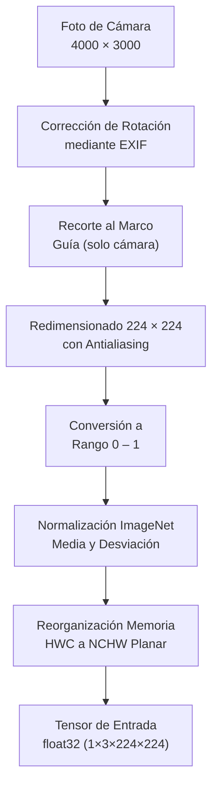

# Pipeline de Inferencia Edge AI en el Dispositivo

Llevar una arquitectura de aprendizaje profundo moderna a un teléfono móvil que opera sin conexión requiere una cuidadosa ingeniería de optimización, empaquetado y procesamiento de tensores.

---

## De PyTorch a TensorFlow Lite Int8

El modelo exportado a la app es **`efficientnet_lite0`** (run oficial `20260921_204608`), una variante concebida para prescindir de activaciones complejas (como *swish* o *hard-swish*) y maximizar la compatibilidad con unidades de procesamiento de punto fijo en chips móviles.

| Modelo / Formato | Precisión Numérica | Tamaño en Disco | Macro-F1 en test (5 015) |
|---|:---:|:---:|:---:|
| **PyTorch (`best.pth`)** | Float32 | 13.79 MB | 0.9480 |
| **ONNX** | Float32 | 13.67 MB | paridad aprobada (max \|Δprob\| 3e-6) |
| **TFLite** | Float32 | 13.56 MB | paridad aprobada (max \|Δprob\| 4e-7) |
| **TFLite Cuantizado (Int8)** | **Entero 8-bit** | **3.74 MB** | **0.9489** (acuerdo con PyTorch 99.74 %) |

En el Motorola edge 40 neo (Dimensity 7030) el preprocesado toma 98 ms (p95 279 ms) y la inferencia 23 ms (medianas). El paso final de redimensionado replica byte a byte el bilineal con antialias de Pillow del entrenamiento (`src/ml/resample.ts`, comprobado contra Pillow en las pruebas de la app); los lados de 896 px o más se reducen antes a la mitad con el filtro lineal de Skia. Con el tensor del propio teléfono, el int8 del servidor reproduce sus predicciones en 143 de 143 imágenes.

::: tip CUANTIZACIÓN POST-ENTRENAMIENTO (PTQ)
La cuantización reduce en un **72 %** el peso del archivo respecto al TFLite Float32 y mantiene el Macro-F1 del test completo (0.9489 frente a 0.9480). La paridad de una muestra de 30 imágenes no se aprobó por una sola imagen límite (max |Δprob| 0.198 frente al umbral 0.15).
:::

---

## Contrato de Preprocesamiento de Píxeles

Un error habitual en aplicaciones de visión artificial móvil es procesar la imagen de manera distinta a como fue entrenada la red neuronal. DoctorMaiz implementa un pipeline estricto de preprocesamiento:

### 1. Corrección EXIF
Los sensores de cámara de Android no rotan los píxeles físicamente al tomar fotos verticales: almacenan una etiqueta numérica de orientación EXIF (`Orientation: 6` para 90° CW). El decodificador de Skia aplica esa orientación antes de cualquier cálculo para evitar que la red analice hojas giradas.

### 2. Recorte Central Asistido (*Crop to Overlay*)
Al capturar con la cámara de la app, el recorte proyecta el marco guía (260 × 320 dp, centrado) sobre la foto y le suma un 15 % de margen (`src/utils/cropOverlay.ts`); el resultado es rectangular, no cuadrado, y se estira a 224 × 224 sin conservar la proporción, igual que el entrenamiento. Si el recorte abarca el 98 % o más de la foto en ambos lados, se usa la foto completa. Las fotos elegidas de la galería no pasan por este recorte: el selector del sistema ofrece un recorte 1:1.

### 3. Normalización ImageNet
Los canales RGB escalados entre $[0, 1]$ se normalizan según la ecuación:
$$\text{Canal}_{\text{norm}} = \frac{(\text{Pixel} / 255.0) - \mu_c}{\sigma_c}$$
con constantes de referencia:
$$\mu = [0.485, 0.456, 0.406], \quad \sigma = [0.229, 0.224, 0.225]$$

### 4. Transposición Planar (NCHW)
Los motores gráficos móviles entregan un arreglo entrelazado $[H, W, C]$ (R, G, B, R, G, B...). Para satisfacer la entrada del modelo convolucional, el buffer se reordena en memoria a formato planar $[1, C, H, W]$.

---

## Motor TFLite con `react-native-fast-tflite`

- La app ejecuta el modelo con `react-native-fast-tflite`, que se apoya en Nitro Modules para llamar a TensorFlow Lite desde JavaScript sin pasar por el puente tradicional de React Native.
- La inferencia se invoca con `model.runSync`, de modo que su tiempo se mide aislado del resto del pipeline: mediana de 23 ms.
- El modelo se carga sin delegados, es decir, se ejecuta en la CPU del teléfono.

---

## Rechazo de imágenes no reconocidas

La app marca una imagen como "No reconocida" si se cumple cualquiera de estas tres condiciones (`src/ml/imageTensor.ts`, `src/ml/TFLiteInferenceEngine.ts`):

1. La probabilidad de la clase más probable es menor que 0.6.
2. La diferencia entre las probabilidades de las dos clases más probables es menor que 0.15.
3. La distancia de Mahalanobis relativa (RMD) supera el umbral de `ood_stats.json`: 106.37 (percentil 95 de validación).

Para la tercera, el modelo exporta una segunda salida con el vector de 1280 dimensiones de la capa previa a la clasificación. La app lo normaliza a norma L2, lo proyecta con PCA a 182 dimensiones (99.01 % de la varianza) y calcula

$$\text{RMD}(x) = \min_{c} d_c(x) - d_0(x)$$

donde $d_c$ es la distancia de Mahalanobis al cuadrado al centroide de la clase $c$ (covarianza compartida) y $d_0$ la distancia al cuadrado a una gaussiana de fondo ajustada sobre todo el conjunto de entrenamiento. El mismo cálculo y el mismo umbral se obtienen en `scripts/pipeline/compute_ood_stats.py`.
