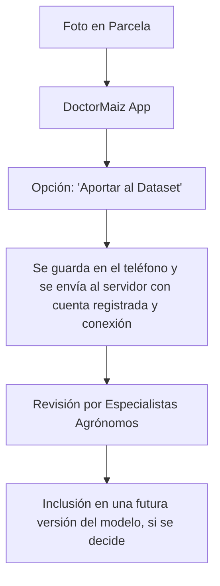

# Aporte a la Ciencia: Dataset Nacional de Maíz

El entrenamiento de algoritmos de inteligencia artificial depende de la diversidad geográfica de sus fotografías. Sin embargo, en la investigación inicial de DoctorMaiz se evidenció una realidad contundente: **de los datasets públicos internacionales evaluados, ninguno incluía imágenes capturadas en Centroamérica**.

DoctorMaiz convierte a cada agricultor en un colaborador activo de la ciencia mediante su módulo de **Contribución Ciudadana**.

---

<PhoneGallery gap="2rem">
  <PhoneMockup 
    src="/app/pixel4_contribute.png" caption="Módulo de Contribución" subtitle="Selección y envío de fotografías" />
  <PhoneMockup 
    src="/app/contribuir.png" caption="Validación Comunitaria" subtitle="Aporte a la investigación regional" />
</PhoneGallery>

---

## Por qué los Modelos Globales Fallan en Nuestra Región

Los modelos entrenados con imágenes de otros continentes sufren una pérdida de precisión cuando se aplican en parcelas locales debido a factores ecológicos particulares:

1. **Variedades y Genética Criolla:** Las variedades locales (como híbridos *CENTA H-59*, *Pasaquina* o maíces criollos de montaña) presentan una textura foliar, vellosidad y coloración distinta a las variedades de Norteamérica.
2. **Suelos Volcánicos y Deficiencias Complejas:** Los andosoles y vertisoles salvadoreños presentan dinámicas de fijación de fósforo muy marcadas, provocando manchas rojizas que modelos extranjeros confunden fácilmente con virosis.
3. **Clases poco representadas en datasets internacionales:** Las deficiencias nutricionales de fósforo y potasio tienen muy pocas imágenes públicas de campo, sobre todo de variedades locales.

---

## Cómo Funciona el Envío de Muestras

El agricultor puede aportar fotografías, tomadas con la cámara o elegidas de la galería, y asignarles la etiqueta de diagnóstico que considere correcta (el aporte no parte de un escaneo ni usa la predicción del modelo). Las fotos están destinadas al **Dataset Nacional**:

### Qué se envía
- **Lo que se envía:** la fotografía, la etiqueta que elegiste, tu nota opcional y la fecha del aporte.
- **Lo que no se envía:** tu nombre, teléfono, correo y coordenadas GPS. La app no los incluye en el envío; el servidor asocia el aporte a tu cuenta.
- **Procesamiento de la foto:** antes de guardarse se reduce a 1024 px de ancho y se recodifica como JPEG (calidad 0.8). No se verificó si esa recodificación elimina los metadatos EXIF.
