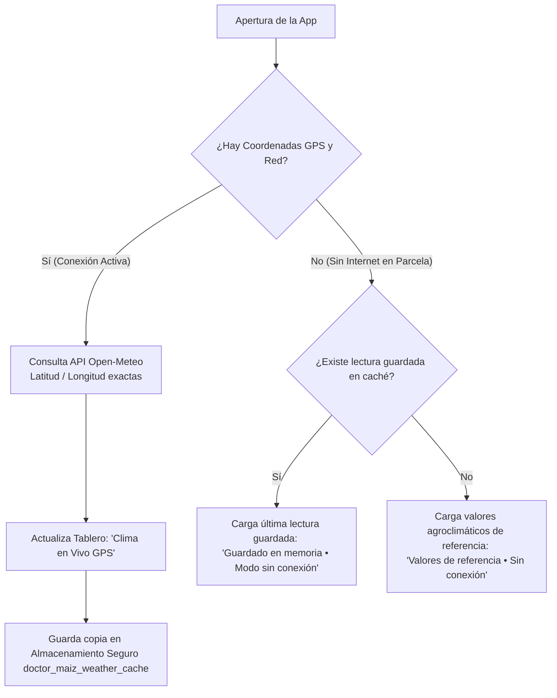

# Monitoreo Agroclimático y Alertas de Campo

Las enfermedades foliares en el cultivo de maíz no aparecen de forma espontánea: son el resultado de la interacción entre el hospedero (la planta de maíz), el patógeno (las esporas del hongo) y el **ambiente meteorológico** (el triángulo de la enfermedad). 

DoctorMaiz integra un tablero de 4 variables meteorológicas directamente en la pantalla de inicio y muestra, para cada una, un criterio de manejo agronómico.

---

<PhoneGallery gap="2rem">
  <PhoneMockup 
    src="/app/pixel4_home_top.png" caption="Tablero Agroclimático" subtitle="4 variables con estado de conexión" />
  <PhoneMockup 
    src="/app/home.png" caption="Pantalla de Inicio" subtitle="Acceso directo al escáner y mapa" />
</PhoneGallery>

---

## Las 4 Variables Evaluadas

Al tocar cualquiera de las 4 tarjetas o el distintivo inferior en la pantalla principal, se despliega el **Modal de Criterio Agroclimático**, con la interpretación de la variable seleccionada. Los umbrales son los de `src/services/weather/weatherService.ts`:

### 1. Temperatura Ambiental (°C)
- **Alerta:** de 20 °C a 28 °C, ambos incluidos. Fuera de ese rango la app muestra "Rango Favorable".
- **Criterio de la app:** temperaturas entre 20 y 28 °C combinadas con humedad foliar favorecen la germinación de esporas de hongos como la roya (*Puccinia sorghi*) y el tizón foliar (*Exserohilum turcicum*).
- **Recomendación en lote (en alerta):** revisar el envés de las hojas intermedias; si hay pústulas aisladas, aplicar preventivos biológicos (*Bacillus subtilis*) o silicio antes de que se extienda.

### 2. Humedad Relativa del Aire (%)
- **Alerta:** superior al 80 % (estrictamente mayor).
- **Criterio de la app:** si supera el 80 % de manera prolongada (con rocío foliar por más de 6 a 8 horas), el riesgo de ataque por hongos y bacterias foliares es elevado.
- **Recomendación en lote (en alerta):** no aplicar productos sistémicos sobre follaje mojado por rocío, porque el agua lava el producto; esperar a que el follaje seque.

### 3. Humedad del Suelo
Open-Meteo entrega la humedad volumétrica de la capa de 0 a 1 cm (`soil_moisture_0_to_1cm`), y la app la clasifica en tres estados. Si el dato falta, el estado es "Adecuada".

| Estado | Rango volumétrico | Mensaje de la app |
|---|:---:|---|
| **Seca** | $< 0.15\ \text{m}^3/\text{m}^3$ | Déficit hídrico (advertencia): estrés hídrico que hace a la planta más vulnerable al gusano cogollero; programar riego o mantener cobertura de rastrojo. |
| **Adecuada** | $0.15 - 0.38\ \text{m}^3/\text{m}^3$ | Capacidad de campo adecuada: mantener el esquema habitual. |
| **Exceso de Agua** | $> 0.38\ \text{m}^3/\text{m}^3$ | Alerta de suelo encharcado: suspender riego y abrir zanjas de desagüe para evitar asfixia radicular. |

### 4. Velocidad del Viento (km/h)
- **Alerta:** superior a 15 km/h (estrictamente mayor).
- **Criterio de la app:** con más de 15 km/h el viento desvía la gota (deriva) y acelera la dispersión de esporas entre parcelas.
- **Recomendación en lote (en alerta):** no hacer aspersiones foliares en ese momento; esperar a las primeras horas de la mañana o al atardecer.

---

## Arquitectura Offline-First de Clima

¿Cómo obtiene la aplicación estos datos si el agricultor no tiene internet en la milpa?

1. **Consulta Georreferenciada con Open-Meteo:** Cuando el teléfono obtiene su ubicación y hay red, consulta la API de Open-Meteo con las coordenadas GPS (sin API key). Las coordenadas salen del teléfono hacia ese servicio; la espera máxima es de 3.5 s.
2. **Caché local:** La lectura se guarda en `expo-secure-store` (clave `doctor_maiz_weather_cache`).
3. **Sin cobertura:** Si no hay ubicación o la consulta falla, la app muestra la última lectura guardada con el distintivo *Guardado en memoria • Modo sin conexión*. Si no hay ninguna lectura guardada, usa valores de referencia fijos (24 °C, 65 % de humedad, 12 km/h de viento, suelo "Adecuada") con el distintivo *Valores de referencia • Sin conexión*. Los escaneos guardan temperatura y humedad solo cuando la lectura es en vivo o guardada, no cuando son valores de referencia.
