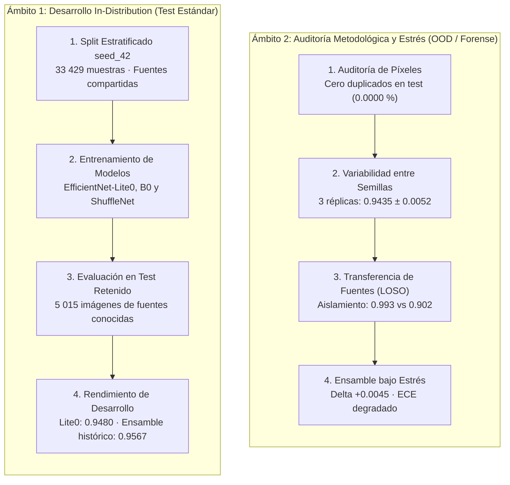

# Auditoría Metodológica y Pruebas de Estrés

Esta sección consolida las investigaciones de auditoría forense e integridad metodológica desarrolladas para evaluar críticamente el clasificador de maíz. Su propósito es **separar con rigor científico lo que el modelo logra dentro de fuentes conocidas frente a cómo reacciona ante variabilidad estocástica y cambio de dominio**.

---

## 1. Delimitación de Dos Ámbitos Experimentales

Para interpretar correctamente las métricas del proyecto y evitar contradicciones aparentes, es imprescindible distinguir los dos escenarios evaluados:

| Dimensión | Ámbito 1: Desarrollo *In-Distribution* | Ámbito 2: Auditoría y Estrés *Out-of-Distribution* |
|---|---|---|
| **Pregunta científica** | ¿Cuál es el techo de rendimiento del modelo cuando las condiciones de campo y cámaras son compartidas? | ¿Qué ocurre cuando cambian las semillas aleatorias, o cuando se evalúa sobre una fuente o región nunca antes vista? |
| **Partición evaluada** | `seed_42` estratificada por clase y entorno (70 % train / 15 % val / 15 % test). | Protocolos de exclusión completa de fuente (LOSO) y réplicas con múltiples semillas (42, 123, 2026). |
| **Uso de los resultados** | Selección de arquitectura móvil para la app y benchmarking estándar de clasificación. | Control de calidad metodológico, detección de atajos visuales y evaluación de generalización real. |

---

## 2. Matriz Resumen de las Cinco Observaciones Críticas

Durante la fase de revisión del proyecto se plantearon cinco observaciones metodológicas sobre posibles limitaciones del pipeline inicial. Cada una fue sometida a pruebas empíricas formales con evidencia cruda versionada:

| # | Observación Inicial | Procedimiento Experimental Ejecutado | Hallazgo Objetivo | Estado Contractual | Reporte Detallado |
|:---:|---|---|---|:---:|:---:|
| **1** | **Una sola semilla:** Las métricas dependían de `seed_42`, haciendo que variaciones $< 0.01$ fueran indistinguibles de ruido estocástico. | Entrenamiento y evaluación del baseline en **tres semillas** (`42`, `123`, `2026`) con selección bloqueada antes de test. | Macro-$F_1$ en test de **$0.943489 \pm 0.005158$**. Variaciones menores a medio punto porcentual son compatibles con la dispersión estocástica. | **Cerrado con SD muestral** | [Estabilidad entre Semillas](./estabilidad-semillas) |
| **2** | **Fuga por procedencia:** La partición aleatoria mezcla fuentes; se sospechaba una caída masiva y homogénea por atajos visuales. | Cuantificación de contingencia ($V \text{ de Cramér} = 0.5030$) y evaluación LOSO de las dos fuentes predominantes. | **Comportamiento asimétrico:** `maize-diseases` generaliza casi perfecto ($0.9933 \pm 0.0006$); la caída se focaliza en `multicrop` ($0.9019 \pm 0.0044$) por `lethal_necrosis`. | **Aislado y caracterizado** | [Procedencia y Fuentes LOSO](./analisis-fuentes-loso) |
| **3** | **15 grupos contradictorios:** Sospecha de 15 grupos de imágenes idénticas pero con etiquetas opuestas penalizando al modelo. | Auditoría píxel a píxel (`pixel_sha256`) sobre las 33 437 imágenes del corpus canónico. | El número de 15 no se reprodujo en el corpus actual; se detectaron exactamente **4 grupos (8 archivos)** en una fuente y fueron **excluidos contractualmente**. | **Blindado (0 en train/test)** | [Auditoría de Píxeles](./auditoria-pixeles) |
| **4** | **0.68 % de gemelos en test:** Sospecha de duplicados idénticos cruzando entre el conjunto de entrenamiento y el de prueba. | Cruce de hashes de archivos (`file_sha256`) y de rasters RGB decodificados (`pixel_sha256`) en `seed_42`. | **0 imágenes de test afectadas (0.0000 %)**. Cero solapamiento exacto en la materialización vigente. | **Refutado para duplicados exactos** | [Auditoría de Píxeles](./auditoria-pixeles) |
| **5** | **Ensamble fuera de fuente:** Nunca se había medido si la ventaja de $+0.0083$ del ensamble sobrevivía fuera de dominio. | Reentrenamiento de los tres modelos y evaluación del ensamble excluyendo `multicrop-disease-maiz` en tres semillas. | **Resultado mixto e inestable:** $\Delta$ medio de **$+0.004468 \pm 0.007993$** (mejora en 2 seeds, empeora en 1) y empeoramiento severo de la calibración (ECE de 0.045 a 0.089). | **Resuelto con resultado mixto** | [Ensamble Fuera de Dominio](./ensamble-loso) |

---

## 3. Navegación de los Reportes de Auditoría

Para profundizar en cada una de las pruebas con sus tablas de predicciones, matrices de confusión y código ejecutable:

1. [**Variabilidad Estocástica y Dispersión entre Semillas**](./estabilidad-semillas): Análisis de la desviación estándar muestral ($\sigma \approx 0.0052$) del baseline frente a pequeñas mejoras de hiperparámetros.
2. [**Procedencia, Asociación Fuente-Patología y LOSO**](./analisis-fuentes-loso): Tabla de contingencia de las 11 fuentes, cálculo de V de Cramér y resultados de exclusión de fuentes completas.
3. [**Auditoría Forense de Píxeles y Duplicados**](./auditoria-pixeles): Verificación determinista de 33 437 imágenes, exclusión de conflictos cross-label y límites de la deduplicación perceptual.
4. [**Comportamiento del Ensamble Fuera de Dominio**](./ensamble-loso): Evaluación pareada de Soft Voting frente a `EfficientNet-B0` bajo estrés de fuente no vista.
