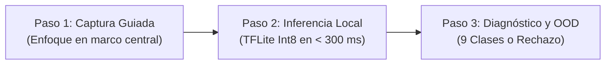
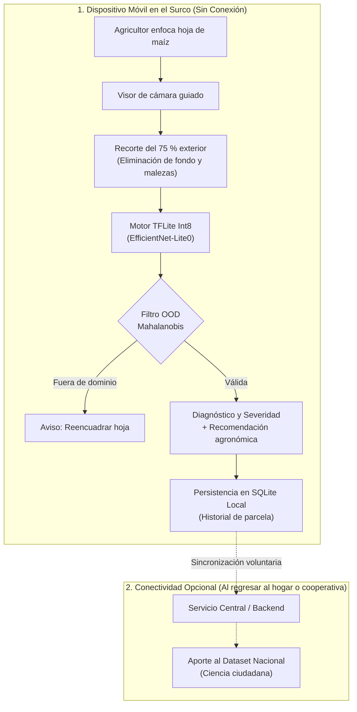

# Presentándonos

  📱 Android 8.0+
  ⚡ Inferencia &lt; 300 ms
  📡 100 % Offline
  🎯 9 Clases Fitosanitarias
  🛡️ Filtro OOD Mahalanobis

**DoctorMaiz** es una herramienta integral de diagnóstico foliar basada en Deep Learning, diseñada para operar en el borde (*Edge AI*) de forma **100 % offline** en teléfonos Android de gama media y baja en El Salvador.

Esta guía te permitirá conocer el funcionamiento de la herramienta, sus requisitos, el flujo de diagnóstico en tres pasos y cómo interactuar con el modelo tanto desde la aplicación móvil como mediante código.

## Componentes de la Herramienta

La solución se compone de dos herramientas complementarias:

  <a href="/es/app/" class="dm-interactive-card">
    

      

        📱 DoctorMaiz App
      

      

        React Native
      

      

        Aplicación móvil para pequeños agricultores y técnicos de campo. Incorpora cámara con visor guiado, inferencia local instantánea sin internet, bitácora de escaneos y catálogo fitosanitario.
      

    

    

      Ver Manual de la App →
    

  </a>

  <a href="/es/deployment/prototipo" class="dm-interactive-card">
    

      

        🧠 Modelo Edge (TFLite Int8)
      

      

        EfficientNet-Lite0
      

      

        Red neuronal cuantizada a enteros de 8 bits (peso ≤ 14 MB). Procesa imágenes de 224×224 px en menos de 300 ms en la CPU del teléfono con filtro de rechazo anómalo (Mahalanobis OOD).
      

    

    

      Ver Ficha Técnica Edge →
    

  </a>

## Requisitos Previos

Antes de comenzar en el surco, verifica los requisitos mínimos recomendados para el funcionamiento óptimo de la aplicación:

  

    
📱 Sistema Operativo

    
Android 8.0 (Oreo / API 26+) o superior

  

  

    
⚡ Procesador / CPU

    
ARM64 (Snapdragon 4xx/6xx o Helio)

  

  

    
🧠 Memoria RAM

    
2 GB mínima recomendada

  

  

    
📷 Cámara

    
Sensor con autoenfoque (≥ 5 MP)

  

  

    
💾 Almacenamiento Libre

    
50 MB (modelo 14 MB + SQLite local)

  

  

    
📡 Conectividad en Campo

    
0 % requerida (100 % offline)

  

## Inicio Rápido en 3 Pasos

El siguiente flujo ilustra cómo realizar un diagnóstico foliar completo en cuestión de segundos:

  

    Paso 1
    Captura Guiada en Campo
  

  <ol style="padding-left: 1.25rem; margin: 0.5rem 0;">
    <li>Abre la aplicación <strong>DoctorMaiz</strong> en tu teléfono móvil y pulsa el botón <strong>«Nuevo Escaneo»</strong>.</li>
    <li>Apunta la cámara hacia la hoja afectada. La pantalla desplegará un <strong>marco guía central</strong>.</li>
    <li><strong>Regla de oro:</strong> Ajusta la distancia para que el tejido foliar cubra la totalidad del marco central.</li>
    <li><em>¿Por qué este diseño?</em> El sistema recorta automáticamente el área exterior antes de clasificar la imagen, eliminando el suelo, las malezas y los fondos engañosos que podrían confundir a la red neuronal (<em>mitigación de atajos visuales</em>).</li>
  </ol>

  

    Paso 2
    Inferencia Local Instantánea
  

  

    Una vez tomada la fotografía, el motor de inferencia procesa la imagen directamente en el procesador del teléfono:
  

  <ul style="padding-left: 1.25rem; margin: 0.5rem 0;">
    <li><strong>Redimensionado:</strong> La imagen se ajusta a 224 × 224 píxeles en RGB.</li>
    <li><strong>Normalización:</strong> Se estandarizan los canales cromáticos con los parámetros de referencia de ImageNet (media = [0.485, 0.456, 0.406], desv = [0.229, 0.224, 0.225]).</li>
    <li><strong>Ejecución:</strong> El modelo cuantizado evalúa la muestra en aproximadamente <strong>180 a 280 milisegundos</strong> en la CPU móvil.</li>
  </ul>

  

    Paso 3
    Interpretación del Diagnóstico y Filtro Fuera de Dominio
  

  

    El sistema entrega el diagnóstico categorizado en una de las 9 condiciones objetivo:
  

| Categoría | Clase Detectada | Síntoma Principal de Confirmación |
|:---:|---|---|
| Sano | **Planta sana (`healthy`)** | Lámina foliar verde uniforme, sin pústulas ni lesiones. |
| Enfermedad | **Roya común (`common_rust`)** | Pústulas pulverulentas de color marrón rojizo en ambas caras. |
| Enfermedad | **Tizón foliar del norte (`nclb`)** | Lesiones elípticas grandes en forma de cigarro, grisáceas. |
| Enfermedad | **Mancha gris (`gls`)** | Lesiones rectangulares estrechas delimitadas por nervaduras. |
| Enfermedad | **Necrosis letal (`lethal_necrosis`)** | Clorosis severa y secado progresivo desde los márgenes. |
| Plaga | **Gusano cogollero (`fall_armyworm`)** | Agujeros irregulares con acumulaciones de excremento en el verticilo. |
| Nutrición | **Deficiencia de nitrógeno (`n`)** | Clorosis en forma de "V" en hojas inferiores (más viejas). |
| Nutrición | **Deficiencia de fósforo (`p`)** | Coloración púrpura/violácea en bordes y puntas de hojas jóvenes. |
| Nutrición | **Deficiencia de potasio (`k`)** | Secado y necrosis marginal estricta en hojas inferiores. |

::: tip 🛡️ ¿Qué pasa si se escanea un objeto que no es una hoja de maíz?
DoctorMaiz incorpora un **módulo de detección fuera de distribución (OOD)** basado en distancia de Mahalanobis. Si el usuario escanea un zapato, una pared, tierra o la mano del agricultor, el sistema no forzará un diagnóstico erróneo: la app mostrará un aviso de **«Muestra no reconocida»** y solicitará reencuadrar la hoja de maíz.
:::

## Arquitectura de Funcionamiento

El siguiente esquema resume el flujo integral de datos desde la captura en el campo salvadoreño hasta el registro local en la base de datos del agricultor:

## ¿Qué deseas explorar ahora?

Para profundizar en el aspecto que más te interese, te sugerimos los siguientes destinos:

  <a href="/es/app/guia-inicio/instalacion" class="dm-interactive-card">
    

      
📱 Manual de la App

      
Aprende a instalar la aplicación, gestionar parcelas y realizar escaneos guiados.

    

    

      Guía de Instalación →
    

  </a>

  <a href="/es/app/catalogo-enfermedades/" class="dm-interactive-card">
    

      
🌿 Catálogo de Enfermedades

      
Consulta la galería visual de patógenos, agentes causales y síntomas foliares.

    

    

      Ver Catálogo →
    

  </a>

  <a href="/es/pipeline/entrenamiento" class="dm-interactive-card">
    

      
⚙️ Pipelines de Entrenamiento

      
Inspecciona el código de preprocesamiento, contratos de runs y optimización Optuna.

    

    

      Ver Pipelines →
    

  </a>

  <a href="/es/auditoria/" class="dm-interactive-card">
    

      
🛡️ Auditoría Metodológica

      
Examina las pruebas forenses de píxeles, estabilidad multi-semilla y evaluación LOSO.

    

    

      Ver Auditoría 5 Puntos →
    

  </a>

