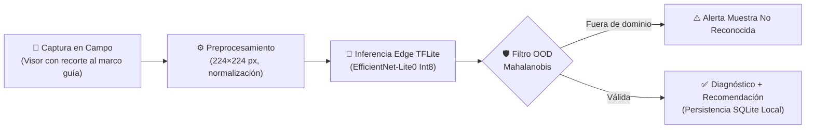

  

    
33 429

    
Muestras elegibles

  

  

    
0.948

    
Macro-F1 de prueba (Lite0)

  

  

    
3.74 MB

    
Modelo int8

  

  

    
23 ms

    
Inferencia en el teléfono (mediana)

  

## El Proyecto

**Detección de Enfermedades Foliares, Plagas y Deficiencias Nutricionales en Cultivos de Maíz mediante Deep Learning en Dispositivos Móviles**

Universidad de El Salvador, Facultad de Ingeniería y Arquitectura, Escuela de Sistemas Informáticos. Curso de Especialización en Machine Learning, Ciclo I 2026. Autores: Josias Abner Rivas Fuentes, David Alejandro Deras Cerros y Elmer Edenilson Rosales Molina.

### Contexto y Problema

La agricultura representa el 5.6 % del PIB de El Salvador y es el sustento de más de 2 millones de personas rurales. El 82.1 % de los productores son pequeños agricultores, muchos operando a nivel de subsistencia. El maíz, su principal cultivo, es vulnerable a enfermedades foliares, plagas y deficiencias nutricionales que, sin detección temprana, pueden destruir hasta el 70 % de la cosecha.

En zonas rurales el acceso a asistencia agronómica presencial es limitado, por lo que el diagnóstico recae casi exclusivamente en la intuición empírica. Esto provoca detecciones tardías y pérdidas acumuladas significativas.

### Clases Objetivo del Modelo

El sistema evalúa 9 condiciones foliares agrupadas en cuatro categorías fitosanitarias: **tejido sano** (control de referencia), **enfermedades infecciosas**, **plagas** y **deficiencias nutricionales**:

| Categoría | Clase | Nombre en inglés | Agente / Causa | Síntoma visual | Lab | Real | Total |
|:---:|---|---|---|---|---:|---:|---:|
| Sano | **Hoja sana** | Healthy | Control biológico (tejido óptimo) | Sin lesiones, lámina foliar verde uniforme | 0 | 8 740 | 8 740 |
| Enfermedad | **Roya común** | Common Rust | *Puccinia sorghi* | Pústulas anaranjadas pulverulentas en ambas caras | 2 150 | 106 | 2 256 |
| Enfermedad | **Tizón foliar del norte (NCLB)** | Northern Corn Leaf Blight | *Exserohilum turcicum* | Lesiones elípticas grisáceas con bordes difusos | 888 | 5 942 | 6 830 |
| Enfermedad | **Mancha gris de la hoja (GLS)** | Gray Leaf Spot | *Cercospora zeae-maydis* | Lesiones rectangulares estrechas delimitadas por nervaduras | 513 | 1 417 | 1 930 |
| Enfermedad | **Necrosis letal del maíz (MLN)** | Lethal Necrosis | *MCMV + SCMV* | Moteado severo, clorosis y secado progresivo | 0 | 6 415 | 6 415 |
| Plaga | **Gusano cogollero** | Fall Armyworm | *Spodoptera frugiperda* | Masticación irregular y excrementos en el verticilo | 0 | 4 853 | 4 853 |
| Nutrición | **Deficiencia de nitrógeno** | Nitrogen Deficiency | Carencia de N | Amarillamiento en "V" desde la punta en hojas viejas | 0 | 846 | 846 |
| Nutrición | **Deficiencia de fósforo** | Phosphorus Deficiency | Carencia de P | Bordes y puntas púrpuras/violáceas en hojas jóvenes | 0 | 938 | 938 |
| Nutrición | **Deficiencia de potasio** | Potassium Deficiency | Carencia de K | Secado y necrosis marginal en hojas inferiores | 0 | 621 | 621 |
| **Total** | **9 clases objetivo** | — | — | — | **3 551** | **29 878** | **33 429** |

Corpus activo de 33 429 muestras elegibles (3 551 de laboratorio y 29 878 de campo) tras 8 exclusiones. Ver [Generalización entre fuentes](/es/resultados/generalizacion) y [Pipeline de Datos](/es/metodologia/pipeline-datos).

### Metodología

El proyecto sigue el ciclo **CRISP-DM**:

1. **Comprensión del negocio**: análisis de las condiciones de campo y limitaciones de conectividad rural en El Salvador.
2. **Comprensión de los datos**: consolidación multi-fuente de 11 fuentes (`source_id`) internacionales; ver [Fuentes de datos](/es/datasets/).
3. **Preparación de los datos**: filtrado de atajos, normalización a 224 × 224 px y balanceo de clases.
4. **Modelado**: transfer learning y benchmarking con EfficientNet-B0, EfficientNet-Lite0 y ShuffleNet-V2.
5. **Evaluación**: macro-F1, calibración, evaluación con fuentes retenidas (LOSO) y detección de muestras anómalas (OOD).
6. **Despliegue móvil**: cuantización Int8 post-entrenamiento (TFLite) y empaquetado en aplicación Android nativa offline.

### Arquitectura de Inferencia

### Restricciones Técnicas de Despliegue

  

    
📱 Dispositivo Objetivo

    
Android 8.0+ (ARM64, gama media/baja)

  

  

    
📦 Tamaño del Modelo

    
3.74 MB (TFLite Int8 post-cuantización)

  

  

    
⚡ Latencia de Inferencia

    
23 ms de inferencia y 98 ms de preprocesado (medianas); meta de 300 ms en total

  

  

    
📡 Requisito de Red

    
Inferencia sin conexión

  

