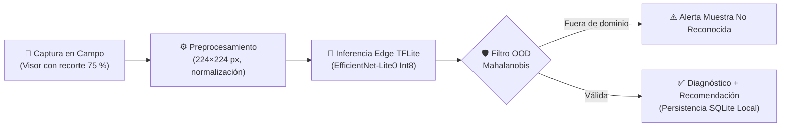

  

    
33 429

    
Muestras Foliares Curadas

  

  

    
&lt; 300 ms

    
Inferencia en CPU Móvil

  

  

    
≤ 14 MB

    
Modelo Cuantizado Int8

  

  

    
100 %

    
Autonomía Offline

  

## El Proyecto

**Detección de Enfermedades Foliares, Plagas y Deficiencias Nutricionales en Cultivos de Maíz mediante Deep Learning en Dispositivos Móviles**

  

    🎓 Universidad de El Salvador
    🏛️ Facultad de Ingeniería y Arquitectura
    💻 Escuela de Sistemas Informáticos
  

  

    Trabajo desarrollado en el marco del <strong>Curso de Especialización en Machine Learning</strong> (Ciclo I 2026 — Grupo 02), bajo la cátedra del <strong>Ing. Bladimir Díaz Campos</strong>.
  

  

    Equipo de Desarrollo e Investigación
  

  

    

      
JR

      

        
Josias Abner Rivas Fuentes

        
RF20010

      

    

    

      
DD

      

        
David Alejandro Deras Cerros

        
DC19019

      

    

    

      
ER

      

        
Elmer Edenilson Rosales Molina

        
RM20001

      

    

  

### Contexto y Problema

Para entender por qué existe este proyecto conviene partir del peso que tiene la agricultura en El Salvador: representa el **5.6 % del PIB** y es el sustento de más de **2 millones de personas rurales**. El 82.1 % de los productores son pequeños agricultores, muchos operando a nivel de subsistencia. El maíz, su principal cultivo, es vulnerable a enfermedades foliares, plagas y deficiencias nutricionales que, sin detección temprana, pueden destruir hasta el 70 % de la cosecha.

En zonas rurales el acceso a asistencia agronómica presencial es limitado, por lo que el diagnóstico recae casi exclusivamente en la intuición empírica. Esto provoca detecciones tardías y pérdidas acumuladas significativas.

### Clases Objetivo del Modelo

El sistema evalúa 9 condiciones foliares agrupadas en cuatro categorías fitosanitarias: **tejido sano** (control de referencia), **enfermedades infecciosas**, **plagas** y **deficiencias nutricionales**:

| Categoría | Clase | Nombre en inglés | Agente / Causa | Síntoma visual | Lab | Real | Total |
|:---:|---|---|---|---|---:|---:|---:|
| Sano | **Hoja sana** | Healthy | Control biológico (tejido óptimo) | Sin lesiones, lámina foliar verde uniforme | 0 | 8 740 | 8 740 |
| Enfermedad | **Roya común** | Common Rust | *Puccinia sorghi* | Pústulas anaranjadas pulverulentas en ambas caras | 2 150 | 106 | 2 256 |
| Enfermedad | **Tizón foliar del norte (NCLB)** | Northern Corn Leaf Blight | *Exserohilum turcicum* | Lesiones elípticas grisáceas con bordes difusos | 888 | 5 942 | 6 830 |
| Enfermedad | **Mancha gris de la hoja (GLS)** | Gray Leaf Spot | *Cercospora zeae-maydis* | Lesiones rectangulares estrechas delimitadas por nervaduras | 513 | 1 417 | 1 930 |
| Enfermedad | **Necrosis letal del maíz (MLN)** | Lethal Necrosis | *MCMV + SCMV* | Moteado severo, clorosis y secado progresivo | 0 | 6 415 | 6 415 |
| Plaga | **Gusano cogollero** | Fall Armyworm | *Spodoptera frugiperda* | Masticación irregular y excrementos en el verticilo | 0 | 4 853 | 4 853 |
| Nutrición | **Deficiencia de nitrógeno** | Nitrogen Deficiency | Carencia de N | Amarillamiento en "V" desde la punta en hojas viejas | 0 | 846 | 846 |
| Nutrición | **Deficiencia de fósforo** | Phosphorus Deficiency | Carencia de P | Bordes y puntas púrpuras/violáceas en hojas jóvenes | 0 | 938 | 938 |
| Nutrición | **Deficiencia de potasio** | Potassium Deficiency | Carencia de K | Secado y necrosis marginal en hojas inferiores | 0 | 621 | 621 |
| **Total** | **9 clases objetivo** | — | — | — | **3 551** | **29 878** | **33 429** |

> 📊 **Distribución muestral:** Corpus activo con **33 429 muestras elegibles** (3 551 laboratorio + 29 878 campo real) tras 8 exclusiones metodológicas auditadas. Ver [Auditoría Metodológica](/es/auditoria/) y [Pipeline de Datos](/es/metodologia/pipeline-datos).

### Metodología

El proyecto avanza en fases iterativas siguiendo el ciclo estándar **CRISP-DM**:

1. **Comprensión del negocio**: análisis de las condiciones de campo y limitaciones de conectividad rural en El Salvador.
2. **Comprensión de los datos**: consolidación multi-fuente de 8 repositorios internacionales; ver [Recopilación de datasets](/es/datasets/).
3. **Preparación de los datos**: filtrado de atajos, normalización a 224 × 224 px y balanceo de clases.
4. **Modelado**: transfer learning y benchmarking con arquitecturas MobileNet, EfficientNet y ResNet.
5. **Evaluación y Auditoría**: macro-F1, análisis de calibración, partición LOSO por origen y detección de muestras anómalas (OOD).
6. **Despliegue móvil**: cuantización Int8 post-entrenamiento (TFLite) y empaquetado en aplicación Android nativa offline.

### Arquitectura de Inferencia

### Restricciones Técnicas de Despliegue

  

    
📱 Dispositivo Objetivo

    
Android 8.0+ (ARM64, gama media/baja)

  

  

    
📦 Peso Máximo Modelo

    
≤ 14 MB (TFLite Int8 post-cuantización)

  

  

    
⚡ Latencia de Inferencia

    
&lt; 300 ms por fotograma en CPU

  

  

    
📡 Requisito de Red

    
100 % Autónomo (Cero datos móviles)

  

