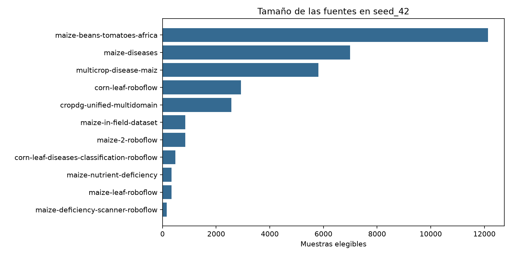
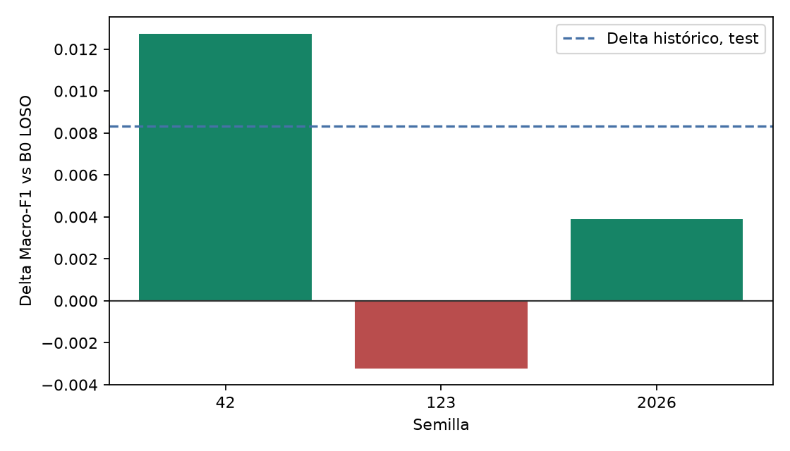

# Generalización entre fuentes

Cada repositorio del corpus fue fotografiado con sus propias cámaras, fondos e iluminación, y varios contienen una sola clase. Si el modelo identifica la fuente en lugar de la lesión, una partición aleatoria sobreestima su desempeño. Esta página reúne las evaluaciones que retienen fuentes completas y las pruebas de atajo.

| Protocolo | Unidad que no cruza particiones | Qué mide |
|---|---|---|
| `seed_42` estratificado | muestra | Desempeño dentro de fuentes conocidas |
| `seed_42_source_grouped` | `source_id` completo | Una asignación única de fuentes a train, validación y prueba |
| LOSO | una fuente | Transferencia a una fuente nunca vista |
| CV agrupada por fuente | `source_id` por pliegue | Sensibilidad a qué fuentes quedan retenidas |

Las cifras de protocolos distintos no se restan entre sí. Especificación en [Protocolos experimentales](/es/metodologia/protocolos-experimentales).

## Asociación entre fuente y clase

El corpus tiene 11 fuentes y 9 clases. De las 99 celdas fuente × clase, 65 están vacías y el V de Cramér es 0.5030 (χ² = 67 673.21), una asociación moderada a fuerte entre origen y patología. Dos fuentes contienen solo `gray_leaf_spot`; `maize-diseases` es 67.8 % `healthy` y aporta el 54.2 % de esa clase; `multicrop-disease-maiz` aporta el 50.4 % de `lethal_necrosis`. Reporte y tablas en [`SOURCE_ANALYSIS.md`](../reproducibilidad/evidencia/source_analysis/SOURCE_ANALYSIS.md).

## LOSO con el modelo oficial

Se excluye una fuente completa de la preparación, el entrenamiento y la selección de hiperparámetros; el checkpoint se bloquea y se evalúa sobre la fuente excluida. Tres semillas (42, 123, 2026), Lite0 con la configuración del modelo oficial.

| Fuente excluida | Imágenes de train | Imágenes del holdout | Macro-F1 del holdout (media ± SD) |
|---|---:|---:|---:|
| `maize-diseases` | 18 519 | 6 989 | 0.993264 ± 0.000600 |
| `multicrop-disease-maiz` | 19 328 | 5 816 | 0.901906 ± 0.004422 |

Por semilla en `multicrop-disease-maiz`: 0.905490, 0.896964 y 0.903264. La caída se concentra en `lethal_necrosis`: esa fuente aporta más de la mitad de los casos de la clase, y excluirla altera su distribución de entrenamiento. Ante `maize-diseases` el modelo transfiere casi sin pérdida. La brecha entre fuentes no es uniforme.

Evidencia: [`LOSO_RESULTS.md`](../reproducibilidad/evidencia/loso_baseline/LOSO_RESULTS.md) y [`MULTISEED_SOURCE_STABILITY.md`](../reproducibilidad/evidencia/multiseed_source_stability/MULTISEED_SOURCE_STABILITY.md).

## Ensamble bajo LOSO

Se reentrenaron desde cero Lite0, B0 y ShuffleNet-V2 excluyendo `multicrop-disease-maiz` (5 816 imágenes de holdout, tres clases presentes) y se promediaron sus softmax sin reajustar pesos.

| Semilla | Lite0 | B0 | ShuffleNet-V2 | Ensamble | Δ ensamble − B0 |
|:---:|---:|---:|---:|---:|---:|
| 42 | 0.905490 | 0.917318 | 0.913037 | 0.930055 | +0.012737 |
| 123 | 0.896964 | 0.934785 | 0.886505 | 0.931569 | −0.003216 |
| 2026 | 0.903264 | 0.919831 | 0.888009 | 0.923713 | +0.003883 |
| Media ± SD | 0.901906 ± 0.004422 | 0.923978 ± 0.009443 | 0.895850 ± 0.014896 | 0.928446 ± 0.004168 | +0.004468 ± 0.007993 |

La ventaja del ensamble es positiva en dos semillas y negativa en una. El ECE pasa de 0.0446 en B0 a 0.0891 en el ensamble, porque promediar modelos no calibrados aumenta la confianza en las predicciones erróneas. Por eso la app despliega un solo modelo. Evidencia: [`ENSEMBLE_LOSO_REPORT.md`](../reproducibilidad/evidencia/ensemble_loso/ENSEMBLE_LOSO_REPORT.md).

## Benchmark source-grouped

Corrida `20260921_180112` (Lite0, `seed_42_source_grouped`): 16 554 train, 7 809 validación y 9 066 prueba, con las once fuentes como grupos indivisibles (proporciones 49.52 / 23.36 / 27.12 %).

| Campo | Valor |
|---|---:|
| Épocas ejecutadas / solicitadas | 12 / 60 (mejor época 4) |
| Macro-F1 de validación | 0.266927 |
| Macro-F1 de train al cierre | 0.966368 |
| Macro-F1 de prueba | 0.400665 |
| Accuracy de prueba | 0.585705 |

La validación no contiene `fall_armyworm` ni `lethal_necrosis` y la prueba la forman tres fuentes completas, de modo que las proporciones se apartan de 70 / 15 / 15. No es comparable con el run estratificado: cambia la pregunta. Evidencia: [resumen](./evidencia/run_20260921_180112_summary.json) e [historial](./evidencia/run_20260921_180112_train_history.csv).

## Campaña de procedencia (etapa 2)

Experimentos históricos con el Lite0 de la etapa 2 sobre 14 identificadores de procedencia (los 11 `source_id` vigentes separan versiones de algunos de ellos). Los archivos de cada ejecución están en [evidencia de procedencia](/es/provenance/evidencia/).

| Experimento | Resultado |
|---|---|
| Anillo perimetral: se tapa el 90 % central y se entrena solo con el 10 % del borde | 78.3 % de aciertos en prueba (azar: 11.1 %) |
| LOSO de 11 pliegues sobre 33 268 imágenes | Macro-F1 0.5573 y accuracy 68.84 % |
| LOSO con balanceo de grupos de procedencia | Macro-F1 0.5594 y accuracy 70.09 % |
| LOSO con sustitución de fondos (BackMix) | Macro-F1 0.5609 y accuracy 69.81 % |

Las dos intervenciones quedan dentro de la dispersión entre semillas (σ ≈ 0.007) y no cierran la brecha. Por clase, las abundantes y presentes en varias fuentes retienen más del 80 % de su F1 (hoja sana, necrosis letal, roya, tizón), mientras que las deficiencias y la mancha gris caen más (potasio de 0.58 a 0.20, fósforo de 0.74 a 0.29).

### Validación cruzada 2×2

Cinco pliegues, Lite0, estratificada frente a agrupada por fuente. ± es la semiamplitud del IC95.

| Configuración | Estratificada | Agrupada por fuente |
|---|---:|---:|
| Configuración base | 0.9311 ± 0.0099 (SD 0.0080) | 0.6026 ± 0.1240 |
| Lite0 con hiperparámetros del trial 12 de B0 | 0.9463 ± 0.0052 | 0.6499 ± 0.1508 |

El Macro-F1 agrupado se calcula sobre las clases presentes en cada pliegue (5 a 8); contando las ausentes como cero, el de la configuración base es 0.4359. Con las fuentes repartidas entre pliegues, cada pliegue estratificado es esencialmente el mismo experimento, por lo que su intervalo estrecho describe homogeneidad del protocolo y no robustez. Todos los pliegues están en [`kfold_2x2_comparacion.csv`](./evidencia/kfold_2x2_comparacion.csv).

## Ablación de la periferia y equidad (etapa 2)

Prueba de oclusión sobre las 5 015 imágenes de prueba con el Lite0 `20260812_221429`. La línea de control nulo es responder siempre `healthy` (26.14 %).

| Condición | Área visible | Accuracy | Confianza retenida |
|---|---:|---:|---:|
| Imagen completa | 100.0 % | 97.91 % | 100.0 % |
| Centro tapado (solo anillo periférico) | 63.7 % | 79.46 % | 69.16 % |
| Periferia tapada (solo caja central) | 36.3 % | 42.25 % | 42.66 % |

Con solo la región exterior el modelo conserva ocho de cada diez aciertos, de modo que la periferia porta por sí sola una fracción sustancial de la información de clase (`shortcut_detected = true`). Las dos condiciones tienen áreas distintas, así que la comparación no establece que el fondo pese más que la hoja.

| Entorno | Muestras | Accuracy | Macro-F1 |
|---|---:|---:|---:|
| Campo real | 4 483 | 98.04 % | 0.9215 (9 clases) |
| Laboratorio | 532 | 96.80 % | 0.9423 (3 clases) |

Los Macro-F1 no son comparables entre entornos porque el laboratorio solo contiene tres clases. En las tres clases comunes, la roya falla en el 31.25 % de los casos de campo (5 de 16) frente a 0.31 % en laboratorio: el 95 % de las imágenes de roya de prueba proviene de laboratorio. El exceso de atribución de Grad-CAM y SHAP sobre la hoja es en promedio +0.037, con tres clases por encima del azar y tres por debajo. Datos en [`equidad_metricas.json`](./evidencia/equidad_metricas.json).

## Implicaciones

- La app recorta al marco guía antes de clasificar y rechaza con el detector OOD las imágenes lejanas al espacio de entrenamiento (ver [Despliegue](/es/deployment/prototipo)).
- Ninguna fuente se capturó en El Salvador; cerrar la brecha requiere fotos de campo locales etiquetadas, que el módulo de contribución de la app permite reunir.
